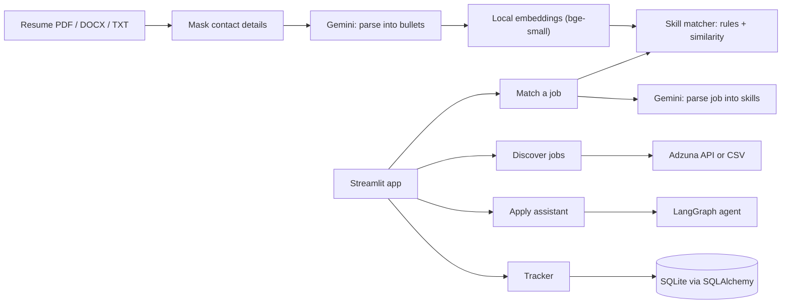
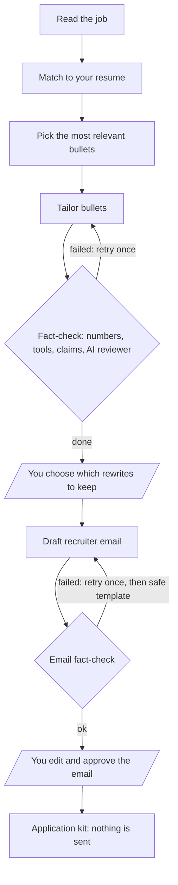

# Job Application Agent

An AI assistant for fresher job hunting that stays honest. It scores how well a job fits your resume, finds jobs, tailors your **real** resume bullets without inventing anything, drafts a recruiter email, and tracks every application with follow-up reminders. **You approve every step. Nothing is ever sent or submitted for you.**

**Live demo:** https://job-application-agent-j86sj27j8u7vsfp85y3fsm.streamlit.app (free hosting: the first load after idle takes a minute)
**Code:** https://github.com/SumitMarothiya81/job-application-agent

<!-- After adding screenshots to docs/screenshots/, remove this comment markers to show them:


-->

## What it does

| Tab                 | What you get                                                                                                                                                                                                                                                                                                                                                            |
| ------------------- | ----------------------------------------------------------------------------------------------------------------------------------------------------------------------------------------------------------------------------------------------------------------------------------------------------------------------------------------------------------------------- |
| **Match a job**     | Paste a job description. Gemini extracts the required and preferred skills; the matcher scores them against your resume (0-100) and labels each skill **explicit**, **related** (a transferable skill, such as Power BI for Tableau) or **missing**. It shows the resume bullet that is the evidence, missing ATS keywords, and optional advice for closing skill gaps. |
| **Discover jobs**   | Search fresher jobs through Adzuna's official API, or import a CSV of jobs you collected. Duplicates are merged, jobs asking for experience are hidden, and the rest are ranked by a quick fit estimate.                                                                                                                                                                |
| **Apply assistant** | A LangGraph agent picks your most relevant bullets, proposes rewrites, fact-checks them, and pauses so **you** choose which to keep. It then drafts a recruiter email and pauses again for your edits.                                                                                                                                                                  |
| **Tracker**         | Application statuses with history, follow-up reminders (in-app and `.ics` calendar files), a response-rate chart per resume version, JSON export/import.                                                                                                                                                                                                                |

## How it stays honest

- **Two-layer fact-check on every rewrite.** First, rules: a rewrite may not add a number, a tool or technology that is not in the original bullet, or inflating words such as "led", "owned", "production-grade". Second, a separate Gemini call acts as fact-checker. A rewrite that fails is retried once and then dropped; your original bullet stays.
- **A rewrite must earn its place.** It is shown only if it adds a keyword the job actually uses, so cosmetic edits ("Added" to "Implemented") never reach you.
- **Humans decide.** The agent pauses twice (LangGraph `interrupt`): once for the rewrites, once for the email. The result is text you copy.
- **If the email cannot be made honest,** the app falls back to a plain template instead of sending a risky one.
- **Privacy.** Your email, phone, profile links and name line are masked **before** any text goes to Gemini. Your Gemini key lives in your browser session only. "Delete my data" removes your indexed resume. Tracing is off by default.
- **No scraping.** Jobs come from Adzuna's official API or your own CSV, never from LinkedIn, Naukri or Indeed pages.

## Architecture



The assistant is a LangGraph graph with a retry loop and two human checkpoints:



## Evaluation

Offline, no API calls: `python -m scripts.run_eval` (full report in [docs/EVALUATION.md](docs/EVALUATION.md)).

| What                                                    | Result                                                                                                                        |
| ------------------------------------------------------- | ----------------------------------------------------------------------------------------------------------------------------- |
| Skill matcher on 41 hand-labelled skills                | **41/41 correct, 0 skills wrongly credited**                                                                                  |
| Rewrite fact-check (rules only) on 41 labelled rewrites | blocks **18/21** dishonest rewrites; wrongly blocks **0/20** faithful ones                                                    |
| What the rules miss                                     | 3 subtle claims ("outperformed all baselines", "clinically validated", a changed meaning). These are left to the AI reviewer. |

Read these as a regression guard, not a benchmark: the sets are small and hand-written, and the related-skill cases come from the same skill groups the matcher uses. The AI reviewer layer is **not** measured offline.

## Run it

**Live:** open the demo link. Demo mode uses a fictional sample resume and has usage limits; choose **My own Gemini key** to upload your resume.

**Locally**

```bash
git clone https://github.com/SumitMarothiya81/job-application-agent.git
cd job-application-agent
python -m venv .venv            # Windows: .venv\Scripts\activate    Mac/Linux: source .venv/bin/activate
pip install -r requirements-dev.txt
cp .env.example .env            # then add your GOOGLE_API_KEY (free from Google AI Studio)
python -m pytest -q             # 222 tests, no API key needed
streamlit run app.py
```

**Docker (self-hosting, one user)**

```bash
docker compose up --build       # then open http://localhost:8501
```

The container is reachable only from your own computer, reads keys from `.env` at run time (never baked into the image), and keeps your tracker in a Docker volume. Exact package versions are in `requirements.lock`.

## Configuration (environment variables)

| Variable                                               | Default                       | Purpose                                                                                 |
| ------------------------------------------------------ | ----------------------------- | --------------------------------------------------------------------------------------- |
| `GOOGLE_API_KEY`                                       | none                          | Gemini key for demo mode                                                                |
| `GEMINI_MODELS`                                        | `gemini-3.5-flash`            | Comma-separated models, tried in order when one is busy                                 |
| `GEMINI_TIMEOUT`, `GEMINI_MAX_RETRIES`                 | `60`, `2`                     | Seconds before a stalled call fails over, and retries per model                         |
| `DEMO_SESSION_LIMIT`, `DEMO_DAILY_LIMIT`               | `5`, `100`                    | Match runs per visitor session and per day in demo mode                                 |
| `AGENT_SESSION_LIMIT`, `AGENT_DAILY_LIMIT`             | `2`, `15`                     | Assistant runs per session and per day                                                  |
| `ADZUNA_APP_ID`, `ADZUNA_APP_KEY`, `ADZUNA_COUNTRY`    | none, none, `in`              | Job search (free keys from developer.adzuna.com)                                        |
| `DISCOVERY_SESSION_LIMIT`, `DISCOVERY_DAILY_LIMIT`     | `5`, `30`                     | Demo search limits                                                                      |
| `RELATED_THRESHOLD`                                    | `0.75`                        | Similarity needed to call an unlisted skill "related"                                   |
| `DATABASE_URL`, `DATA_DIR`                             | local SQLite, `data/sessions` | Tracker database (a Postgres URL works) and indexed resumes                             |
| `SINGLE_USER`                                          | off                           | `true` gives one fixed user so the tracker survives reloads (used by Docker)            |
| `TRACKER_TIMEZONE`                                     | `Asia/Kolkata`                | Timezone for dates and reminders                                                        |
| `ENABLE_TRACING`, `LANGSMITH_API_KEY`, `TRACE_CONTENT` | off                           | Optional LangSmith tracing; prompts and answers stay hidden unless `TRACE_CONTENT=true` |

## Project layout

```
app.py                  Streamlit app (four tabs)
job_agent/
  jd_parser.py          job text -> skills (Gemini + Pydantic)
  resume_*.py, privacy.py, chunking.py, embeddings.py, vector_store.py   resume pipeline
  matching.py           skill matcher and 0-100 score
  verify.py             rule-based honesty checks
  agent.py              LangGraph apply assistant
  discovery.py          Adzuna client, CSV import, dedupe, fresher filter, ranking
  tracker_*.py          tracker rules and SQLAlchemy storage
  evaluation.py         labelled cases and metrics
  llm.py, tracing.py    Gemini client with model fallback; optional tracing
tests/                  222 tests (Gemini is replaced by scripted answers)
```

## Design decisions

- **Local embeddings (fastembed, bge-small).** Free, no rate limits, and your resume never leaves the machine for retrieval.
- **A small numpy store instead of a vector database.** One resume is about 50 chunks; exact search is instant and avoids install problems on free hosts. All access goes through one file, so Chroma or FAISS can replace it.
- **Rules before the AI reviewer.** They are free, instant and consistent, and they catch the most damaging dishonesty (invented numbers and tools). The AI reviewer covers claims in plain words.
- **Model fallback.** Gemini 503s are common on free keys, so each call tries the next configured model.
- **No LLM calls inside the human-approval steps.** LangGraph re-runs an interrupted node from the top on resume, so those nodes contain no model calls.

## Known limitations

- Tests use scripted Gemini answers. Real-model behavior was checked by hand, not by an automated suite.
- Adzuna returns only a short snippet of each job, so "quick fit" in Discover is an estimate; paste the full description in Match tab for the real score.
- Scanned (image-only) PDFs are not supported; there is no OCR.
- On the free public demo the server disk is temporary and each browser session is a separate user, so use **Export** to keep your tracker. For durable storage use Docker or set `DATABASE_URL` to a hosted Postgres.
- Reminders are in-app and calendar files; there is no email or push notification.
- Defaults are India-oriented (timezone, Adzuna country) and English only.
- The Gemini free tier may use prompts to improve Google's models; a paid key does not.
